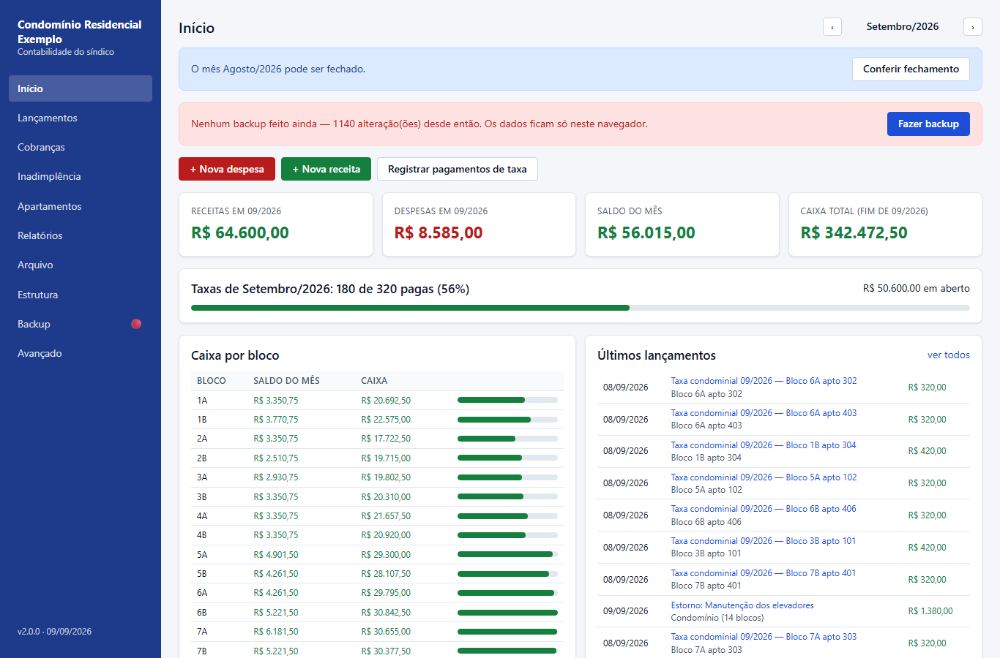

# Contabilidade do Condomínio

Sistema de contabilidade e administração para o síndico de um condomínio com vários blocos: registra
receitas e despesas com comprovantes, controla a taxa condominial de cada apartamento, lista
inadimplentes e emite o demonstrativo com o caixa de cada bloco e do condomínio.

É um **aplicativo web local de arquivo único**: um `.html` que abre por duplo clique no Chrome ou no
Edge, sem servidor, sem instalação e sem internet. Os dados ficam no navegador (IndexedDB) e são
protegidos por backups em ZIP.



## Usar o sistema

1. Baixe [`entrega/Contabilidade-Condominio.html`](entrega/Contabilidade-Condominio.html) (no GitHub, abra o
   arquivo e use **Download raw file**).
2. Abra com duplo clique no Google Chrome ou no Microsoft Edge.
3. Siga o assistente de primeiro uso (mês inicial, nome do condomínio, taxas e saldos dos blocos).

Guia completo do síndico: [LEIAME.md](LEIAME.md).

## Documentação

- [Documentação completa em PDF](docs/Documentacao-Contabilidade-Condominio.pdf) (visão geral, guia do
  síndico, regras contábeis, arquitetura e validação).
- [Visão geral e telas](docs/visao-geral.md)
- [Regras contábeis do demonstrativo](docs/regras-contabeis.md), com cenário numérico reproduzido pelos testes
- [Arquitetura e guia de desenvolvimento](docs/arquitetura.md)
- [Validação da versão 2](docs/validacao-v2.md)

## Funcionalidades

- Lançamentos de despesa e receita com escopo geral (rateado entre os blocos proporcionalmente aos
  apartamentos), por bloco ou por apartamento; transferências entre blocos; anexos.
- Cobranças mensais da taxa por apartamento, pagamento individual ou em lote, juros, desconto,
  cancelamento, isenção e correção; lista de inadimplência.
- Relatórios por período e bloco (base caixa ou competência) com conferência automática; Excel, CSV e PDF.
- Arquivo de documentos (atas, convenção, contratos…).
- Estrutura editável: blocos, apartamentos, taxas com vigência, categorias e saldos iniciais.
- Backup completo ou por ano em ZIP, restauração validada e retomável.
- Fechamento mensal, estorno, verificação de integridade, auditoria detalhada e manutenção.

## Desenvolvimento

Requisitos: Windows com Google Chrome ou Microsoft Edge. O projeto usa um Node 24 portátil em
`.tools/node` (não altera o Node da máquina).

```
powershell -ExecutionPolicy Bypass -File scripts\setup-node.ps1   # uma vez: baixa o Node 24 portátil
. .\scripts\use-node.ps1                                          # em cada terminal fora do VS Code
npm install
npm run typecheck        # TypeScript strict
npm test                 # 600 testes (Vitest)
npm run build            # gera dist/index.html (arquivo único)
npm run empacotar        # copia para entrega/
npm run verificar        # verificação ponta a ponta em Chrome e Edge headless
npm run capturas         # capturas de tela com dados fictícios (docs/capturas)
npm run docs:pdf         # documentação em PDF (docs/ e entrega/)
```

Stack: Vite 8, React 19, TypeScript 5.9, Dexie 4 (IndexedDB), jszip, SheetJS, zod 4, Vitest 5.
Arquitetura em camadas (`ui → exportacao → dados → dominio`) descrita em
[docs/arquitetura.md](docs/arquitetura.md).
